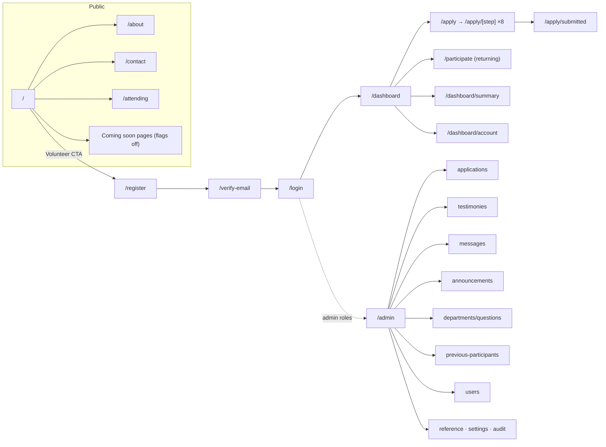
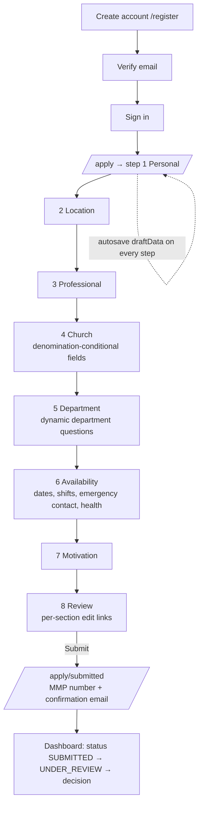
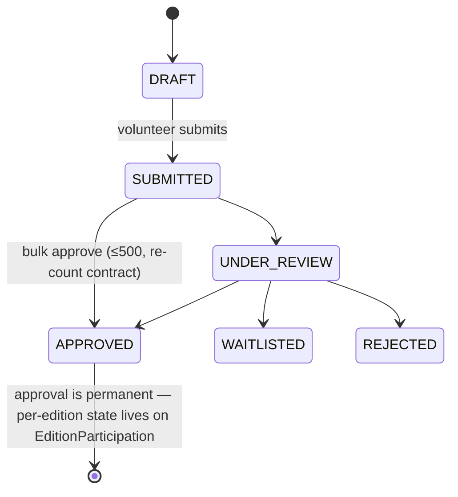
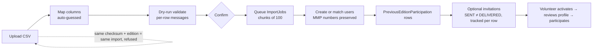

# 03 — App Flow: Screens, Navigation and Key User Flows

Every route below exists in `src/app` (App Router). Route groups carry the guards described in [ARCHITECTURE.md](ARCHITECTURE.md): `(auth)` redirects away if signed in, `(volunteer)` requires `requireUser()`, `(admin)` requires `requireAdmin()` plus per-page `requirePermission()`, `(legal)` is open.

---

## 1. Screen inventory

### Public site (no account needed)

| Route | Screen |
|---|---|
| `/` | Homepage — hero, countdown, activities, testimonies, newsletter signup, volunteer CTA |
| `/about` | About the event and organisation |
| `/contact` | Contact form (categories, stored as `ContactMessage`, never emailed onward) |
| `/attending` | "I will be attending" share-card generator (built entirely in the browser) |
| `/terms`, `/privacy` | Legal pages, opened in a new tab from consent checkboxes |
| Blog / Gallery / Magazine / Radio / Prayer Request / Give | "Coming soon" until the matching `NEXT_PUBLIC_FEATURE_*` flag is on (`src/config/features.ts`) |

### Authentication `(auth)`

| Route | Screen |
|---|---|
| `/register` | Create account (issues the permanent MMP number) |
| `/login` | Sign in by email, username or MMP number |
| `/verify-email` | Email verification landing |
| `/forgot-password`, `/reset-password` | Password recovery |

### Volunteer area `(volunteer)`

| Route | Screen |
|---|---|
| `/apply` | Wizard entry — routes an already-registered volunteer to `/participate` automatically |
| `/apply/[step]` | The eight wizard steps (one page renders all of them): `personal`, `location`, `professional`, `church`, `department`, `availability`, `motivation`, `review` |
| `/apply/submitted` | Confirmation with the MMP number |
| `/participate` | Returning-volunteer edition confirmation: department (previous preselected), department questions, dates, shift periods, overnight, this edition's consents |
| `/dashboard` | Nine-stage journey hero, notifications, announcements, shifts, FAQs, resources |
| `/dashboard/summary` | Printable application summary |
| `/dashboard/account` | Account management (email, password, deletion request) |

### Administration `(admin)` — all under `/admin`

| Route | Screen | Gate (from `src/lib/auth/rbac.ts`) |
|---|---|---|
| `/admin` | Overview command centre — needs-attention queue, event bar, lifecycle counts, trends, recent activity | admin |
| `/admin/applications`, `/admin/applications/[id]` | Applicant list (filters, bulk approve, export) and full application review | `application:view_all` / `view_department`, `application:decide` |
| `/admin/testimonies`, `/admin/testimonies/[id]` | Moderation queue and detail with note timeline | `testimony:moderate` (+ `testimony:contact_view`) |
| `/admin/messages` | Contact inbox — split-view helpdesk | `contact:manage` |
| `/admin/announcements`, `.../new`, `.../[id]` | Announcement lifecycle list and editor | `announcement:manage` |
| `/admin/departments`, `.../[id]`, `.../[id]/questions` | Departments and the question builder with live preview | `department:manage`, `question:manage` |
| `/admin/previous-participants`, `.../new`, `.../[id]` | Legacy CSV migration: batches, upload/map, batch detail | `migration:*` |
| `/admin/users`, `/admin/users/[id]` | Administrators: list, permission matrix, suspend/disable, role history | `user:manage` |
| `/admin/reference` | Countries/states, RCCG hierarchy, lookup options | `reference:manage` |
| `/admin/settings` | Registration open/close and operational settings | `settings:manage` |
| `/admin/audit` | Activity log: All / Security & compliance / System views | `audit:view` |

### API route handlers (`src/app/api`)

| Route | Purpose |
|---|---|
| `GET /api/reference/[resource]` | Cacheable reference lists for the wizard (countries, states, regions, provinces, parishes, lookups) |
| `GET /api/departments/[id]/questions` | Active question set for a department (used by wizard/participate) |
| `GET /api/files/[id]` | Authorised file download — the only way a stored file is served |
| `GET /api/admin/export` | Filtered applicant export (CSV/Excel), audited |
| `GET /api/admin/export/contacts` | Contact-message export |

Plus `robots.ts`, `sitemap.ts`, `opengraph-image.tsx` at the app root.

## 2. Navigation map



The admin shell groups navigation as Overview / Applications / People / Communications / Content / Configuration / Activity and security ([ADMIN-ROADMAP.md](ADMIN-ROADMAP.md), "Admin shell").

## 3. Key user flows

### 3.1 New volunteer registration (once, ever)



Answers to hidden conditional questions are pruned before save (`pruneHiddenAnswers`), asserted in unit and E2E tests.

### 3.2 Returning volunteer (each edition)

```mermaid
flowchart LR
  A[Sign in with email / username / MMP number] --> B{Migrated &<br/>mustReviewProfile?}
  B -->|yes| C[Confirm profile details] --> D
  B -->|no| D[Dashboard hero:<br/>"Confirm your availability"]
  D --> E[/participate: department + questions +<br/>dates + shifts + overnight + consents/]
  E --> F[EditionParticipation SIGNED_UP] --> G[ASSIGNED → CHECKED_IN → COMPLETED<br/>or WITHDRAWN]
```

### 3.3 Application review (admin)



Every transition writes `ApplicationStatusHistory` and an audit entry; decisions carry an optional reason.

### 3.4 Legacy migration (previous participants)



### 3.5 Public testimony

Visitor submits on the homepage → stored `PENDING` with normalised body hash (duplicate detection) → moderator triages in `/admin/testimonies` (assign, note, approve/reject/spam/feature) → nothing renders publicly until approved.

### 3.6 Contact message

Visitor submits `/contact` → stored `NEW` (never emailed onward) → admin inbox: first open records `firstReadAt`, triage priority/assignment/notes → reply via handler's own mail client (`mailto:`) → `RESOLVED`.

---

*Screens verified against `src/app/**` on 2026-09-19. For per-step component code see `src/components/apply/steps/`.*
