# 05 — Backend Schema and API

Source of truth: **`prisma/schema.prisma`** (PostgreSQL, Prisma 7; SQL table names in `@@map` snake_case, listed here). Migrations live in `prisma/migrations/`; seed data in `prisma/seed.ts` + `prisma/seed-data/`. The rationale for the shape — typed columns for anything filtered or reported on, a dynamic EAV engine *only* for department questions, health data isolated — is in [ARCHITECTURE.md §2](ARCHITECTURE.md).

---

## 1. Domain map (ER overview)

```mermaid
erDiagram
    users ||--o{ user_roles : has
    users ||--o{ sessions : has
    users ||--o{ verification_tokens : has
    users ||--|| volunteer_profiles : "0..1"
    users ||--|| volunteer_applications : "0..1 (unique per user)"
    users ||--o{ user_department_scopes : scoped
    users ||--o{ admin_permission_grants : overrides
    users ||--o{ previous_edition_participations : history

    volunteer_profiles }o--|| countries : in
    volunteer_profiles }o--|| states : in
    volunteer_profiles }o--|| church_regions : attends
    volunteer_profiles }o--|| church_provinces : attends
    volunteer_profiles }o--|| parishes : attends
    volunteer_profiles }o--|| volunteer_documents : photo

    volunteer_applications ||--|| emergency_contacts : "0..1"
    volunteer_applications ||--|| application_health_info : "0..1 restricted"
    volunteer_applications ||--o{ application_status_history : trail
    volunteer_applications ||--o{ admin_notes : notes
    volunteer_applications ||--o{ edition_participations : "one per edition"

    edition_participations }o--|| departments : serves
    edition_participations ||--o{ volunteer_availability : dates
    edition_participations ||--o{ application_answers : answers
    edition_participations ||--o{ shift_assignments : rota

    departments ||--o{ department_questions : asks
    department_questions ||--o{ question_options : options
    department_questions ||--o{ department_questions : conditional
    application_answers }o--|| department_questions : answers
    application_answers ||--o{ application_answer_options : chose
    application_answer_options }o--|| question_options : option
    application_answers }o--|| volunteer_documents : attachment

    departments ||--o{ shifts : schedules
    shifts ||--o{ shift_assignments : filled

    announcements ||--o{ announcement_revisions : versions
    announcements ||--o{ announcement_deliveries : sends
    announcements }o--|| departments : audience

    migration_batches ||--o{ migrated_user_records : rows
    migration_batches ||--o{ import_jobs : queue
    migration_batches ||--o{ previous_edition_participations : produced

    testimony_submissions ||--o{ testimony_notes : moderation
    contact_messages ||--o{ contact_notes : handling

    church_continents ||--o{ church_regions : contains
    church_regions ||--o{ church_provinces : contains
    church_provinces ||--o{ church_zones : contains
    church_zones ||--o{ church_areas : contains
    church_provinces ||--o{ parishes : contains
    countries ||--o{ states : contains
```

## 2. Tables by domain

### Identity & access

| Table | Key columns | Notes |
|---|---|---|
| `users` | `email`•, `username`•, `phone`•?, `passwordHash`, **`mmpCode`•?** (the permanent MMP number, e.g. `MMP2214059`), `emailVerifiedAt?`, `isActive`, `failedLogins`, `lockedUntil?`, `deletionRequestedAt?`, migration flags (`isPreviousEditionUser`, `mustReviewProfile`, `migrationSource?`, `profileReviewedAt?`), admin access state (`adminDisabledAt?`, `adminSuspendedUntil?`, `adminNote?`) | `mmpCode` is *the* registration number, issued once for life. |
| `user_roles` | `userId`+`role`• | Role enum: VOLUNTEER, SUPER_ADMIN, REGISTRATION_ADMIN, DEPARTMENT_HEAD, REVIEWER, MEDICAL_INFO_OFFICER, COMMUNICATION_OFFICER. |
| `admin_permission_grants` | `userId`+`permission`•, `granted` (bool), `reason?`, `grantedById?` | Per-person override: `granted=false` revokes even what a role grants. Permission keys from `PERMISSIONS` in `src/lib/auth/rbac.ts`. |
| `role_assignment_history` | `userId`, `change` (GRANTED/REVOKED/SUSPENDED/RESTORED/PERMISSION_*), `subject`, `reason?`, `actorId?` | "How did this person get this access?" — survives audit trimming. |
| `user_department_scopes` | `userId`+`departmentId`• | Restricts department heads/reviewers. |
| `sessions` | `tokenHash`•, `expiresAt`, `revokedAt?`, `ip?`, `userAgent?` | Only the SHA-256 digest is stored. |
| `verification_tokens` | `type` (EMAIL_VERIFICATION/PASSWORD_RESET), `tokenHash`•, `expiresAt`, `usedAt?` | |
| `rate_limit_buckets` | `key`•, `count`, `windowStart`, `expiresAt` | DB-backed fixed-window rate limiting. |

(• = unique; ? = nullable.)

### Reference data

- `countries` (`iso2`•, `iso3`•, `phoneCode`, `hasStates`) → `states` (`countryId`+`name`•).
- RCCG church hierarchy: `church_continents` → `church_regions` → `church_provinces` → `church_zones` → `church_areas`; `parishes` hang off a province and/or area. All rows carry `isActive` + `sortOrder` and are admin-editable.
- `lookup_options` — admin-manageable option lists (`category`: OCCUPATION / EDUCATION / DISCOVERY_SOURCE; `requiresText` for "Other").

### Departments & the dynamic question engine

| Table | Notes |
|---|---|
| `departments` | `slug`•, `name`, `description?`, `isActive`, `sortOrder`. (A former `capacity` column was dropped — Phase 0.) |
| `department_questions` | `departmentId`+`key`•, `label`, `type` (TEXT, TEXTAREA, EMAIL, TEL, NUMBER, DATE, RADIO, CHECKBOX, SELECT, MULTISELECT, FILE, RATING), `isRequired`, `isActive`, constraints (`maxLength`, `minValue`/`maxValue`, `ratingMin`/`Max`, `allowedMimeTypes[]`, `maxFileSizeKb`, `pattern`/`patternMessage`), conditional display via `parentQuestionId` + `parentOptionValues[]` (self-relation). |
| `question_options` | `questionId`+`value`•, `label`, `requiresText` (reveals free text). |

### Volunteer profile, application, participation

| Table | Notes |
|---|---|
| `volunteer_profiles` | 1:1 with user. Name, `gender?`, `ageRange?` (banded enum), phone, minor/guardian consent fields, location (country/state/`stateNameOther`/city/address), occupation/education (+ Other), church (denomination enum RCCG / OTHER_CHRISTIAN / NON_CHRISTIAN, region/province/parish/`parishNameOther`/`churchName`), `photoDocumentId`•?. |
| `volunteer_applications` | **Unique per user** — made once. `registrationId`• (`MMP-2027-000123`, internal only), `status` (DRAFT, SUBMITTED, UNDER_REVIEW, APPROVED, WAITLISTED, REJECTED, ASSIGNED, CHECKED_IN, COMPLETED), `currentStep`, `draftData Json?` (autosaved wizard state, cleared on submit), motivation fields, `submittedAt?`, reviewer/decision fields, submission IP/UA. |
| `edition_participations` | `(applicationId, edition)`•. What changes each edition: `departmentId?`, `status` (SIGNED_UP, ASSIGNED, CHECKED_IN, COMPLETED, WITHDRAWN), `availableOvernight?`, four consent booleans + `consentedAt?`, `confirmedAt?`, `withdrawnAt?`. |
| `volunteer_availability` | `(participationId, date, period)`• — period: MORNING/AFTERNOON/EVENING/OVERNIGHT. |
| `application_answers` | `(participationId, questionId)`•; typed value columns (`valueText`, `valueNumber Decimal(12,2)`, `valueBool`, `valueDate`, `documentId?`). Keyed to the **participation**, so answers per edition never overwrite each other. |
| `application_answer_options` | `(answerId, optionId)`• + `otherText?`. |
| `emergency_contacts` | 1:1 with application: name, relationship, phone, altPhone. |
| `application_health_info` | 1:1, **restricted**: `hasCondition`, `details?`. Isolated table, `health:view` gated, excluded from exports/emails. |
| `volunteer_documents` | `kind` (PROFILE_PHOTO, CERTIFICATE, ANSWER_ATTACHMENT), `storageKey`• (opaque, never exposed), original name/mime/size/checksum/dimensions. |
| `application_status_history` / `admin_notes` | Decision trail and internal notes per application. |

### Scheduling & communication

- `shifts` (`departmentId?`, start/end, location, capacity, period) → `shift_assignments` (`(shiftId, participationId)`•).
- `announcements` — audience (ALL_VOLUNTEERS / DEPARTMENT / APPROVED_ONLY), lifecycle `status` (DRAFT, SCHEDULED, PUBLISHED, EXPIRED, ARCHIVED), `priority`, `scheduledFor?`, `expiresAt?`, channels (`showOnDashboard`, `showAsBanner`, `sendEmail`, `emailSubject?`), `archivedAt?`.
- `announcement_revisions` — `(announcementId, version)`•, full snapshot on every edit ("what exactly did we send?").
- `announcement_deliveries` — per send-run counts (recipients/succeeded/failed) + failed addresses JSON; `isTest` flag.

### Public platform

- `testimony_submissions` — moderation status (PENDING/APPROVED/REJECTED), `bodyHash?` (SHA-256 of normalised body for duplicate detection), advisory `assignedToId?`, `isSpam`, `isTestData`, `featuredAt?`, reviewer fields; → `testimony_notes` timeline.
- `contact_messages` — `category` (GENERAL … DONATION/OTHER), `status` (NEW/IN_PROGRESS/RESOLVED), `priority` (LOW→URGENT), `firstReadAt?` (null = unread), advisory assignment, `messageHash?`, spam/test flags; → `contact_notes` timeline.
- `newsletter_subscribers` — `email`•, consent, confirm/unsubscribe timestamps, source, ip.

### Legacy migration & jobs

- `migration_batches` — `reference`• (`MIG-2026-0007`), source edition/year, `fileChecksum` (unique with `sourceEdition` — same file twice is the same import), private `storageKey?` + retention (`fileDeletedAt?`), `columnMapping Json`, `status` (DRAFT → VALIDATED → QUEUED → IMPORTING → COMPLETED[_WITH_WARNINGS] / FAILED / CANCELLED), row counters.
- `migration_batches.invitationsAutoQueuedAt?` — one-shot guard: the upload-time "send invitations" choice is honoured exactly once when the import completes (atomic `updateMany … where null`).
- `migrated_user_records` — `(batchId, rowNumber)`•, raw `sourceData Json`, `normalisedEmail`, parsed fields, `action` (CREATE / MATCH_EXISTING / SKIP_*), `status`, validation messages, `matchedUserId` (indexed). Invitation state: `invitationStatus` is **pipeline state only** (NOT_QUEUED / QUEUED / SENT / FAILED); `invitationSentKey`• is claimed before sending and released on failure, so non-null ⇒ a successful send happened (survives activation). Orthogonal facts have their own columns: `excludedFromInvites`, `activatedAt`, `profileReviewedAt`. `SUPPRESSED` remains in the enum as a legacy value; nothing writes it since 2026-10-13 (repair migration restored SENT from sent keys).
- `previous_edition_participations` — `(userId, edition)`•; department kept as **free text** (legacy names) — deliberately separate from `edition_participations`. Defines who counts as a "previous participant" (person-level, deduplicated by user).
- `import_jobs` — DB-backed queue for **imports only** (`kind = 'import'`): `(batchId, kind, offset)`•, `status`, `attempts`/`maxAttempts`, claimed via `SELECT … FOR UPDATE SKIP LOCKED`. The old `kind = 'invite'` jobs are retired (cancelled by migration).

### Outreach & follow-up (2026-10-13)

Every bulk email to participants — invitations and reminders — is a **run of per-recipient attempts**; manual follow-up is an append-only contact log. Predicates for audiences and reporting live in `src/lib/outreach/eligibility.ts`, `src/lib/admin/participants.ts` and `src/lib/admin/metrics.ts`; the definitions are documented in [METRICS.md](METRICS.md).

| Table | Key columns |
|---|---|
| `outreach_runs` | `kind` (INVITATION / REMINDER_UNACTIVATED / REMINDER_UNCONFIRMED), `edition`, `templateKey`, `batchId?`, `filtersJson` (audience snapshot the admin approved), `cooldownDays`, `maxRecipients`, planned/sent/failed/skipped counts, **`mailerMode`** (`smtp` / `file` / `unknown` for backfilled history), `status` (QUEUED → RUNNING → COMPLETED[_WITH_ERRORS] / CANCELLED), `createdById?` |
| `outreach_attempts` | `runId`, `userId?`, `recordId?`, `email` snapshot, `kind`, `status` (QUEUED / SENDING / SENT / FAILED / SKIPPED), `error?`, `mailerMode?`, `queuedAt`, `claimedAt?`, `sentAt?`, **`dedupeKey`•** = `runId:recipient` (idempotency). Indexes `(userId, status, sentAt)` for cooldown, `(runId, status)` for progress. Append-only. |
| `outreach_jobs` | `runId`, `seq` — `(runId, seq)`• so a new run always gets fresh jobs; `size` 50 = one pass; same SKIP LOCKED claim as `import_jobs` |
| `participant_contact_logs` | `userId`, `adminId?`, `channel` (PHONE / WHATSAPP / SMS / EMAIL / IN_PERSON / OTHER), `outcome` (AWAITING_RESPONSE / NEEDS_ASSISTANCE / DECLINED / UNREACHABLE / RESOLVED — the **staff** conclusion, never the participant's own response), `notes?`, `contactedAt`, `nextFollowUpAt?`. Indexes `(userId, contactedAt DESC)`, `(nextFollowUpAt)`. Append-only: no update/delete action exists. |

Also added: `users(isPreviousEditionUser, emailVerifiedAt)` and `edition_participations(edition, confirmedAt)` indexes; settings keys `reminder_cooldown_days` (default 7) and `reminder_max_per_run` (default 500).

Backfill limitations (stated in the migrations): one SENT attempt per person was reconstructed from `invitationSentKey`, with approximate timestamps and `mailerMode = 'unknown'`; failed attempts before a success, and `invitedAt` values nulled by past failures, were never recorded and are reported as not tracked.

### Platform

- `audit_logs` — actor, action, entityType/Id, metadata Json, ip, userAgent.
- `settings` — key → Json value (registration open/close etc., read via `src/lib/settings.ts`).

## 3. API surface

Most mutations are **Server Actions** (colocated `actions.ts` files: `(auth)`, `(site)`, `apply`, `participate`, `dashboard/account`, `admin`, `previous-participants`) — Next.js origin-protects them. HTTP Route Handlers exist only where a real response body is needed, and carry an explicit CSRF check (`src/lib/security/csrf.ts`):

| Method & path | Purpose | Auth |
|---|---|---|
| `GET /api/reference/[resource]` | Cacheable reference lists (countries, states, church hierarchy, lookups) | public |
| `GET /api/departments/[id]/questions` | Active question set for a department | signed in |
| `GET /api/files/[id]` | Authorised download of a stored document | owner or permitted admin |
| `GET /api/admin/export` | Filtered applicant CSV/Excel export — accepts every list filter, including `status` (comma list), `confirmed`, `participation`, `submittedFrom/To` (Lagos dates), `imported` | `application:export`, audited |
| `GET /api/admin/export/contacts` | Contact messages export | `contact:manage` |
| `GET /api/admin/previous-participants/export` | Person-level previous-participants CSV — the complete filtered set (same filters as the People screen), paged server-side | `migration:export`, audited |

Server actions added 2026-10-13: `previous-participants/followup-actions.ts` (`logContactAction`, `bulkLogContactAction` — counted contract: `expectedCount` re-checked, cap 500, selection mode `ids` vs `filter`), `previous-participants/outreach-actions.ts` (`previewReminderAction`, `createReminderRunAction` with `expectedCount`, `outreachProgressAction` — the poll that advances sending, `cancelOutreachRunAction`).

Permissions enumerated in `src/lib/auth/rbac.ts`: `application:*` (view_own/edit_own/view_all/view_department/review/decide/assign_shift/note/export), `health:view`, `volunteer:message`, `announcement:manage`, `department:manage`, `question:manage`, `reference:manage`, `settings:manage`, `user:manage`, `audit:view`, `testimony:moderate`, `testimony:contact_view`, `contact:manage`, `migration:view/create/execute/invite/export`, **`migration:followup`** (log manual contact — deliberately separate from `migration:invite`, the mass-email permission; granted to Registration Administrators and Super Administrators).
