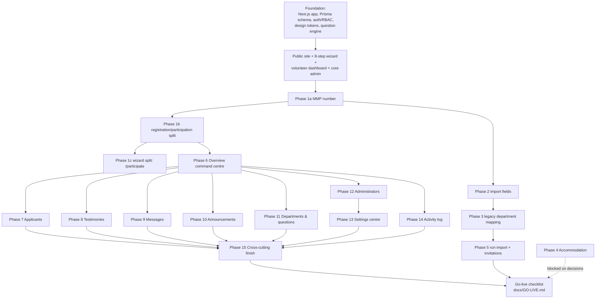

# 06 — Implementation Plan and Current Status

The detailed working plan for the admin platform is **[ADMIN-ROADMAP.md](ADMIN-ROADMAP.md)** (phases, acceptance criteria, blockers) and the launch sequence is **[GO-LIVE.md](GO-LIVE.md)**. This file is the summary view: how the system was built up in dependency order, what is done, and what remains as of 2026-10-13. Metric definitions live in **[METRICS.md](METRICS.md)**.

---

## 1. Phased build order (with dependencies)

The ordering logic: the **volunteer model correction** (Part A — register once, participate per edition) had to land before any admin feature that counts or filters volunteers, because it changed what an "application" is. The **legacy migration** (Phases 2–5) had to preserve MMP numbers issued since 2022, so it depends on Phase 1a. Admin phases (Part B) are sized to be picked up independently once Phase 6's shell and permission gating exist.

## 2. What is built (verified against code and roadmap)

### Foundation and volunteer journey — complete
- Next.js 16 / React 19 / Prisma 7 / Tailwind v4 application with the full schema (44 models), seed data and migrations.
- Auth (scrypt, revocable sessions, email verification, password reset, lockout, rate limiting) and RBAC with per-user permission overrides.
- Eight-step wizard with autosave, conditional questions, review step and submission confirmation; isomorphic question engine shared client/server.
- Volunteer dashboard: nine-stage journey, lifecycle-aware hero, notifications from real timestamps, announcements, FAQs, resources.
- Public site: homepage (countdown, testimonies, newsletter), About, Contact, legal pages, attending share card; everything else feature-flagged "Coming soon"; donations off by client instruction.
- Docker deployment (CI-built images, one-shot migrate container, co-located Postgres, reverse-proxy compose file) plus documented Vercel/systemd alternatives.
- Test suite: Vitest unit/integration + Playwright E2E across desktop/mobile/tablet + axe-core; full suite last recorded at 372 green.

### Part A — volunteer model and migration
| Phase | Status |
|---|---|
| 1a — MMP number (`User.mmpCode`, login by number, 1,392 accounts backfilled) | **Done** |
| 1b — registration/participation split (`EditionParticipation`; 1,478 applications carried to 2027 with zero orphans) | **Done** |
| 1c — wizard split: returning volunteers confirm at `/participate`; wizard runs once | **Done** |
| 2 — import fields (all 20 export columns, enum translation verified 13,969/13,969, legacy MMP numbers preserved) | **Done** |
| 3 — legacy department mapping | **Decided and implemented** (see [DEPARTMENT-MAPPING.md](DEPARTMENT-MAPPING.md)) |
| 4 — Accommodation | **Not started** — blocked on organisational decisions |
| 5 — Running the real import + activation campaign | **Flow built** (upload → map → validate → confirm → import → invite, idempotent); the production run itself is an operational task in [GO-LIVE.md](GO-LIVE.md) |

### Part B — admin platform (each a "first slice done" unless noted)
| Phase | Status | Main remaining items |
|---|---|---|
| 0 — remove department capacity | **Done** (closed fully in Phase 8) | — |
| 6 — Overview command centre | **Done; reworked 2026-10-13** (see below) | — |
| 7 — Applicants | First slice done (bulk approve, gated export, ageing, MMP search) | Reviewer assignment (blocked on advisory/exclusive decision), saved views, column visibility, detail drawer, generic data table; one tracked mobile-emulation investigation |
| 8 — Testimonies | First slice done | Homepage wiring for featured testimonies, categories/tags, spam heuristics |
| 9 — Messages | First slice done | Integrated reply + templates (blocked on reply-channel decision), canned responses, analytics |
| 10 — Announcements | First slice done | Richer audience filters (needs schema), scheduled email worker pass, failed-email retry |
| 11 — Departments & questions | First slice done | Drag-and-drop, draft/publish of whole sets, import/export, answer analytics, remaining field types |
| 12 — Administrators | First slice done | Role descriptions on list, bulk role changes |
| 13 — Settings as configuration centre | **Pending** | Whole phase |
| 14 — Activity log | First slice done | Permission-controlled export, links to related records, retention controls (blocked on retention period) |
| 15 — Cross-cutting finish | **Pending** | Whole phase |

### Operational dashboard & previous-participant follow-up (2026-10-13)

| Part | Status |
|---|---|
| Metric audit & correction — every overview figure from one shared predicate module, department-scoped, links to exactly its records; 17 reporting defects fixed (mixed entities, activation erasing invite history, imported people invisible to "not confirmed", department chart counting unconfirmed/withdrawn, "awaiting review" link undercounting, test data in comms counts, unvalidated `?status=`, UTC-vs-Lagos drift…) | **Done** |
| Invitation queue repair — three bugs that stranded/deadlocked bulk invitations at real scale; invitations now run through the outreach subsystem | **Done** |
| Percentages with named denominators, N/A on zero; four Recharts charts (trend, response stages, participation, department) with click-through and accessible tables | **Done** |
| People view (person-level, deduped by account), person detail, import-rows troubleshooting view, filtered export | **Done** |
| Manual follow-up — append-only contact log, due/overdue queues derived from responses, counted bulk logging | **Done** |
| Reminder campaigns — two audiences, preview + counted confirm, send-time eligibility re-check, cooldown, bounded runs, per-attempt history | **Done** |
| Profile review recorded at wizard submission | **Done** (tracked from 2026-10-13; earlier history never recorded) |
| Edition selector across historical editions | **Not done** — the overview reports the current edition only |
| Background sending without an open admin screen | **Not done** — sending advances while an admin has the batch screen or reminder dialog open (Phase 15 scheduler) |
| Delivery/bounce tracking | **Out of scope** — needs a provider webhook; "Sent" means SMTP acceptance |

## 3. What remains before launch

From [GO-LIVE.md](GO-LIVE.md), [README.md](../README.md) ("Before you open registration") and the roadmap's open decisions:

1. **Organisational decisions** (roadmap "Open organisational decisions"): accommodation model (Phase 4), contact reply channel, reviewer assignment semantics, audit retention period.
2. **Build**: Phase 13 (Settings centre), Phase 15 (cross-cutting finish), plus the per-phase "remaining" items above as later slices.
3. **Operational pre-flight**:
   - Confirm the 2027 event date and set `NEXT_PUBLIC_EVENT_STARTS_AT` (homepage deliberately shows "dates to be announced" until then).
   - Replace seeded RCCG regions/provinces with the official structure (Admin → Reference data).
   - Legal review of the shipped volunteer terms and privacy notice.
   - Supply unverified details from [HOMEPAGE-AUDIT.md](HOMEPAGE-AUDIT.md) (artists, phone, socials, Magazine/Radio destinations).
   - Change the seeded administrator password; configure SMTP and S3.
   - Run the legacy import and invitation campaign (Phase 5 recommendations).
   - `npm run verify` green; nightly `pg_dump` backups from day one ([DEPLOYMENT.md](DEPLOYMENT.md)).
4. **Post-launch switches**: flip `NEXT_PUBLIC_FEATURE_GIVE` (and other flags) when the organisation is ready; each is a one-line env change and redeploy.

## 4. Working rules for every phase

Summarised from the roadmap's shared rules: verify *current state* against code before building; every phase has a "done when" acceptance test; E2E runs on desktop, mobile and tablet; permission gating happens in the query layer; every sensitive read or bulk action writes an audit entry; blocked phases stall — resolve the named decision first.
